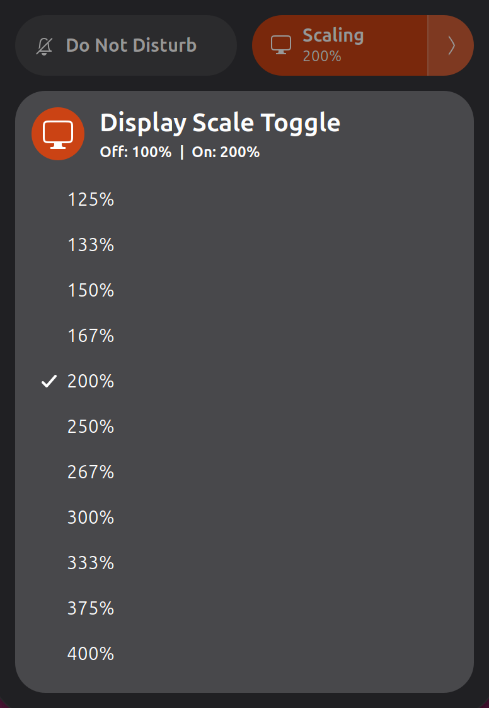

# Display Scale Toggle

**Your normal desktop and your preferred scale, one click apart.**

A GNOME Shell extension that adds a native **Scaling** split button to Quick
Settings. Switch between **100%** and a scale of your choice, with **200%** as
the default.

<p align="center">
  
</p>

## How it works

| Control | Action |
| --- | --- |
| Left side of the tile | Toggle between 100% and your preferred scale. |
| Right-hand arrow | Open the list of scales supported by your current display mode. |
| Choose a scale while off | Remember it for the next activation; stay at 100%. |
| Choose a scale while on | Apply it immediately. |

The tile shows the actual display scale, including changes made in GNOME
Settings. Your preferred on-scale is remembered across logins. Resolution,
refresh rate, rotation, and color mode are preserved.

Scale changes apply to the **current session** without a confirmation dialog.
They do not overwrite the monitor configuration saved by GNOME Settings.
Disabling or uninstalling the extension leaves the current display scale
unchanged.

## Compatibility

- **GNOME Shell 51**, tested on Wayland.
- **One active display**, or a mirrored display group with a shared supported
  scale. Extended multi-monitor layouts are not supported and are never
  rearranged by the extension.
- Available scales depend on the current display mode. The mode must support
  100% for the off state.

The extension uses Mutter's display-configuration API directly. No external
commands, background services, or network access are needed at runtime.

## Install

### Release ZIP

Download the `.shell-extension.zip` from the
[latest release](https://github.com/sunshinedaniel/gnome-display-scaling/releases/latest),
then install it:

```sh
gnome-extensions install --force \
  ./display-scale-toggle@sunshinedaniel.github.io.shell-extension.zip
```

### From source

You need Git, `gnome-extensions`, `glib-compile-schemas`, and GNU gettext
(`msgfmt`).

```sh
git clone https://github.com/sunshinedaniel/gnome-display-scaling.git
cd gnome-display-scaling

glib-compile-schemas --strict schemas
gnome-extensions pack --force \
  --podir=po \
  --extra-source=display-config.mjs \
  --extra-source=LICENSE .
gnome-extensions install --force \
  ./display-scale-toggle@sunshinedaniel.github.io.shell-extension.zip
```

### Enable

After either installation method, **sign out and back in** so GNOME discovers
the extension. Then enable
**Display Scale Toggle** in the Extensions app, or run:

```sh
gnome-extensions enable display-scale-toggle@sunshinedaniel.github.io
```

Open Quick Settings in the top-right corner of your desktop and look for
**Scaling**. Code updates also require a new GNOME Shell session.

## Uninstall

```sh
gnome-extensions disable display-scale-toggle@sunshinedaniel.github.io
gnome-extensions uninstall display-scale-toggle@sunshinedaniel.github.io
```

## Development

The runtime is plain GJS with no third-party dependencies. Node.js is needed
only for the display-configuration unit tests:

```sh
node --test tests/display-config.test.mjs
/usr/bin/python3 tests/check-translations.py
node --input-type=module --check < extension.js
glib-compile-schemas --strict schemas
```

The integration check runs a disposable, headless GNOME Shell on a **private
D-Bus session**. It exercises the native split button, real compositor scale
changes, preference persistence, and cleanup, including cancellation during
an in-flight operation. It does not change your running desktop.

```sh
dbus-run-session --config-file=tests/session-bus.conf -- \
  env SCALE_TOGGLE_PRIVATE_TEST_BUS=1 \
  /usr/bin/python3 tests/shell-smoke.py
```

It needs GNOME Shell 51, Python with PyGObject, and a working headless Mutter
renderer. Native translation checks also require an installed English UTF-8
locale, such as `en_US.UTF-8`, as a language-neutral base for gettext.
The private bus configuration prevents unrelated desktop services from starting.
To capture the real open submenu without the screenshot shortcut closing it,
add:

```sh
dbus-run-session --config-file=tests/session-bus.conf -- \
  env SCALE_TOGGLE_PRIVATE_TEST_BUS=1 \
  /usr/bin/python3 tests/shell-smoke.py \
  --screenshot screenshots/quick-settings.png
```

The automation bootstrap permits Shell evaluation **only inside the disposable
test compositor**. It is not part of the extension and is never included in
the installation ZIP.

### Translations

The tile, submenu, status messages, and display errors use GNOME's standard
gettext integration. The language follows your desktop automatically, with
English as the fallback. Twenty widely used languages are included:

| Language | Locale | Language | Locale |
| --- | --- | --- | --- |
| Arabic | `ar` | Japanese | `ja` |
| Bengali | `bn` | Korean | `ko` |
| Chinese (Simplified) | `zh_CN` | Polish | `pl` |
| English | `en` | Portuguese | `pt` |
| French | `fr` | Russian | `ru` |
| German | `de` | Tamil | `ta` |
| Hindi | `hi` | Thai | `th` |
| Indonesian | `id` | Turkish | `tr` |
| Italian | `it` | Urdu | `ur` |
| Spanish | `es` | Vietnamese | `vi` |

Translation sources live in [`po/`](po/). Native-speaker improvements are welcome;
the initial translations have not been independently reviewed by native speakers.
`gnome-extensions pack --podir=po` compiles and packages the catalogs, so gettext
development tools are not needed by people installing the ZIP.

After changing runtime text, update the template:

```sh
xgettext --language=JavaScript --from-code=UTF-8 \
  --keyword=_ --keyword=translate:1 \
  --package-name='Display Scale Toggle' \
  --output=po/display-scale-toggle.pot \
  extension.js display-config.mjs
```

Run `tests/check-translations.py` to check coverage and interpolation in every
catalog. To exercise a packaged translation in the native GNOME test, use:

```sh
dbus-run-session --config-file=tests/session-bus.conf -- \
  env SCALE_TOGGLE_PRIVATE_TEST_BUS=1 \
  /usr/bin/python3 tests/shell-smoke.py \
  --extension-zip ./display-scale-toggle@sunshinedaniel.github.io.shell-extension.zip \
  --language de
```

## Issues and contributions

[Report a problem or suggest an improvement](https://github.com/sunshinedaniel/gnome-display-scaling/issues).
For display-related problems, include your GNOME version, session type, monitor
layout, current resolution, and requested scale. Do not include credentials or
unrelated personal data.

## License

**GPL-3.0-or-later**. See [LICENSE](LICENSE) for the full license text.
Contributions are accepted under the same terms.
